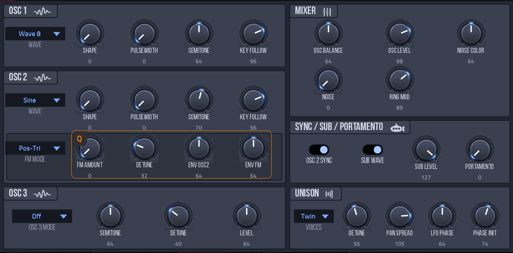
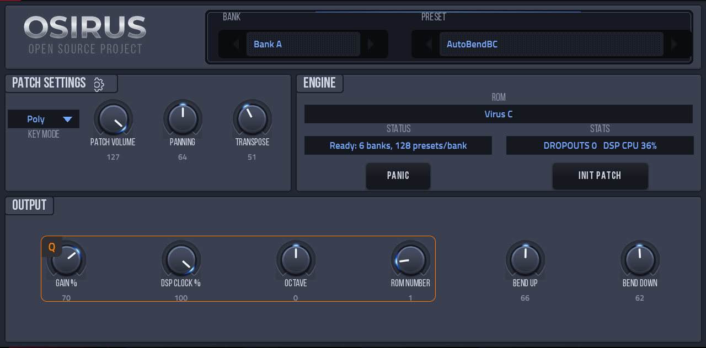
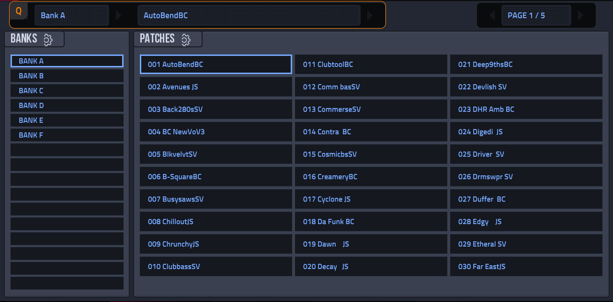

# Osirus for MPC (Gen2)

An emulation of the Access Virus A, B and C synthesizers as a native VST2 instrument for **Akai MPC Gen2** standalone devices (MPC Live III
and kin: aarch64, MPC OS 3.x), with a touchscreen skin and Q-Link control on every page. It runs the original Virus firmware on
[gearmulator](https://github.com/dsp56300/gearmulator)'s DSP56300 emulator ("Osirus" is gearmulator's name for its Virus emulation).



**Status: early release.** Tested on an MPC Live III (MPC OS 3.9.1) with Virus A and C ROMs: sound, skin, banks, presets, Q-Links and knob values work.
Virus B is untested. Gen1 devices and the Force are not supported (the emulator's JIT has no 32-bit ARM backend).

*Osirus is an independent project, not affiliated with or endorsed by Access Music. "Virus" is the name of the instrument it emulates.*

## You need your own ROM
No ROM is included, and none may be shared. Put your own Virus ROM in `osirus/roms/` inside the plugin folder (the folder the installer made, e.g. `/sdcard/Synths/sd88me - VST - Osirus/osirus/roms/`; no other location is searched, and ROMs are read when the plugin loads). If none is found, the PLAY page's status shows the exact folder it looked in:
- **Virus A:** the OS update and preset files as `.mid` (for example `First_A_28.mid` together with `second_A_28.mid`).
- **Virus B / C:** the flash image as `.bin`.

The plugin finds the ROMs when it starts; with several, **ROM NUMBER** on the main page picks one (A, then B, then C). Extra banks from
SysEx `.mid` dumps in `osirus/banks/` show up as banks after the ROM's own.

## Using it
Add *Osirus* to a plugin track. Pages (tabs at the bottom): **PLAY** (title bar with the preset and bank steppers, Patch Settings,
engine status and an INIT PATCH button, output controls), **BANKS** (bank list and the patches of the current bank, 30 per page),
**OSC** (oscillators 1-3, mixer, ring mod, sub, unison, portamento), **FILTER**, **ENV**, **LFO 1+2**, **LFO 3 / ARP**, **MOD** (slots 4-6 appear on a Virus B or C only), **FX 1** (distortion, analog boost, punch, phaser, chorus), **FX 2** (equalizer, delay and reverb), **VELOCITY**.
Every four Q-Links form a column that MPC outlines on the page; every knob shows its value under its label. The data wheel steps the preset.
MPC's PRESET menu has `INIT` (the ROM's own "- Init -" single) and `Default`.

**DSP CLOCK %** (PLAY page) is how fast the emulated DSP runs: 100 is the real instrument's speed. Lower it only if the CPU can't keep up
(the STATS readout shows dropouts and the emulator's CPU). On an MPC Live III a Virus C at 100% uses about half of one fast core.

## Install
Use the [MPC plugin catalog](https://sd88me.github.io/mpc-vst-plugins/) (its installer or `mpc-store.sh`), or download `Osirus-<version>-mpc-aarch64.zip` from
[Releases](https://github.com/sd88me/mpc-vst-osirus/releases), unzip it, copy the folder to the device and run `sh install.sh` as root: it stops and
restarts MPC and backs up `MPC.settings`. On a Live III the writable drive is `/nvme/Synths` (`sh install.sh -t /nvme/Synths`); the zip's INSTALL.md has the details.
Then put your ROM in the plugin folder's `osirus/roms/` and add Osirus to a plugin track. The release has no ROM in it.




## Building
Needs Docker, Python 3 with Pillow, and a checkout of [mpc-vst-plugins](https://github.com/sd88me/mpc-vst-plugins) (`MPC_VST`, default
`~/mpc-vst-plugins`):
```
./build.sh test      # x86 engine + the wrapper's host test (ASan/UBSan)
./build.sh all       # aarch64 vst/build/aarch64/osirus.so + the skin (cross compiled in Docker)
tools/preview.sh X   # draw every skin page offline into vst/preview/X/
```
Release zip (no ROM, checked against the catalog rules): `./release.sh <version>`; then `gh release create v<version> dist/Osirus-<version>-mpc-aarch64.zip`.
Building needs mpc-vst-plugins with the skin tool's `vy=` option (its main branch once PR #550 is merged). `test/engine_test.cpp` boots a ROM from
`<dir>/roms/` and checks notes, presets, banks, tiles and saved state: `build/x86/osirus_engine_test <dir> [seconds]`.

## How it is put together
`src/gearmulator/` is the vendored Virus emulation and the DSP56300 JIT; `src/dsp/virus_plugin.cpp` is
[schwung-virus](https://github.com/charlesvestal/schwung-virus)'s glue, changed to run the emulator on a thread of MPC's own process;
`src/dsp/mpc_engine.cpp` maps it to the plugin wrapper of mpc-vst-plugins. `tools/gen_params.py` writes the parameter list from the
source; `tools/make_layout.py` cuts sections out of the Galaxpel skin art and places the live controls. Details and what was changed:
`src/VENDORED.md`, `docs/DEVELOPMENT.md`.

## Credits and licences
Osirus stands on the work of others; see [CREDITS.md](CREDITS.md) for the full list and each licence. In short:
the Virus emulation and the DSP56300 emulator are **[gearmulator](https://github.com/dsp56300/gearmulator) / [dsp56300](https://github.com/dsp56300/dsp56300)** (GPL-3.0),
the plugin glue is adapted from **[schwung-virus](https://github.com/charlesvestal/schwung-virus)** by Charles Vestal (GPL-3.0),
the skin art is the **"Galaxpel" skin by Emre Babus** from gearmulator's Osirus plugin (GPL-3.0), the JIT is **[AsmJit](https://github.com/asmjit/asmjit)** (zlib),
and the font is Bebas Neue (SIL OFL 1.1). Osirus is **GPL-3.0** ([LICENSE](LICENSE)).
Not affiliated with or endorsed by Access Music; no ROM is included.
