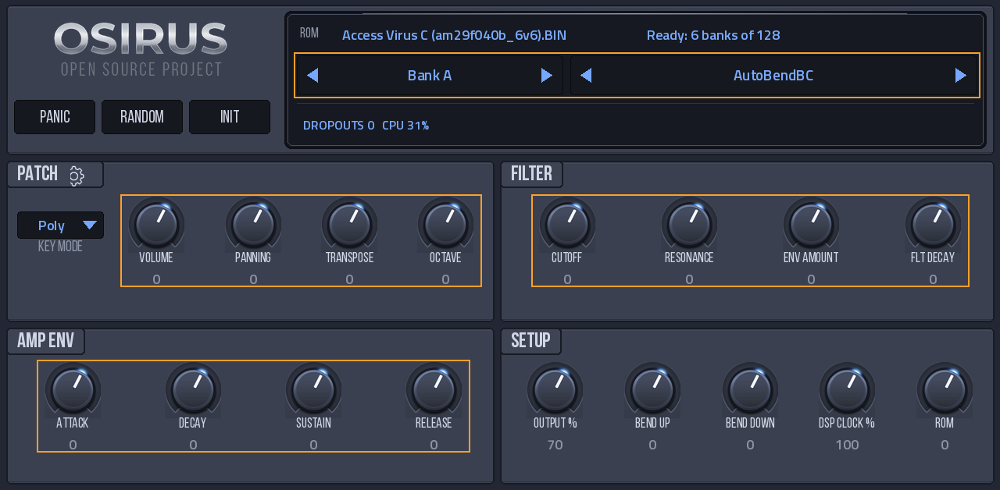
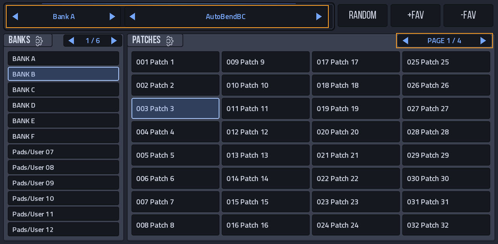

# Osirus for MPC (Gen2)

An emulation of the Access Virus A, B and C synthesizers as a native VST2 instrument for **Akai MPC Gen2** standalone devices (MPC Live III
and kin: aarch64, MPC OS 3.x), with a touchscreen skin and Q-Link control on every page. It runs the original Virus firmware on
[gearmulator](https://github.com/dsp56300/gearmulator)'s DSP56300 emulator ("Osirus" is gearmulator's name for its Virus emulation).



**Status: 1.0.0.** A new native plugin with the same name and identity as 0.2.x: projects and Q-Link assignments made with 0.2.x load in it.
Tested on an MPC Live III with a Virus C ROM: sound, every page, banks, presets, favourites and RANDOM. Virus A and B are untested in 1.0. Gen1 devices and the Force are not supported (the emulator's JIT has no 32-bit ARM backend).

*Osirus is an independent project, not affiliated with or endorsed by Access Music. "Virus" is the name of the instrument it emulates.*

## You need your own ROM
No ROM is included, and none may be shared. Put your own Virus ROM in `osirus/roms/` inside the plugin folder (see [Install](#install) for where that is). No other location is searched, and ROMs are read when the plugin loads. If none is found, the PLAY page's status shows the exact folder it looked in:
- **Virus A:** the OS update and preset files as `.mid` (for example `First_A_28.mid` together with `second_A_28.mid`).
- **Virus B / C:** the flash image as `.bin`.

The plugin finds the ROMs when it starts; with several, **ROM NUMBER** on the PLAY page picks one (A, then B, then C). The choice is saved with the project. Changing it restarts the emulator once, a moment after you stop turning the knob (the status line says "switching..."); stepping through values never restarts it once per step, which crashed some hosts. Extra banks from
SysEx `.mid` or `.syx` dumps in `osirus/banks/` show up as banks after the ROM's own.

## Using it
Add *Osirus* to a plugin track. Pages (tabs at the bottom): **PLAY** (one display with the ROM, status, bank and preset steppers and the
DROPOUTS / CPU readout; PANIC, RANDOM and INIT; patch, filter, amp envelope and setup controls), **BANKS** (12 banks a page, the patches of
the current bank in four columns of eight, RANDOM, +FAV and -FAV),
**OSC** (oscillators 1-3, mixer, ring mod, sub, unison, portamento), **FILTER**, **ENV**, **LFO 1+2**, **LFO 3 / ARP**, **MOD** (slots 4-6 appear on a Virus B or C only), **FX 1** (distortion, analog boost, punch, phaser, chorus), **FX 2** (equalizer, delay and reverb), **VELOCITY**.
Every four Q-Links form a column that MPC outlines on the page; every knob shows its value under its label. The data wheel steps the preset.
## Your own patches: banks and favourites
- **Banks.** Put Virus SysEx bank dumps (`.mid` or `.syx`, the single-patch dumps a Virus or a patch editor exports) in `osirus/banks/` inside the plugin folder
  and reload the plugin. Sub-folders work (two levels deep): each file is an extra bank after the ROM's own, named `Folder/File`, up to 64 banks in all,
  paged on the BANKS page.
- **RANDOM** (PLAY and BANKS) loads a random patch from all loaded banks.
- **Favourites.** On the BANKS page, **+FAV** opens a keyboard with the patch's name: edit it and press SAVE to store the current patch, including your knob
  changes, from any bank (ROM or your own). **-FAV** removes the favourite that is currently loaded. Up to 64 are kept in `osirus/favourites.dat`; they show by name in MPC's PRESET menu, where picking one loads it.
  A favourite holds the patch itself, so it still works if the bank file it came from is gone. It remembers the Virus model it was made on (A, B or C):
  the PRESET menu lists it as `Name [C]` on a matching ROM and as `Name <C>` on another, which is not loaded.

## Levels and crackle
There are three levels, in signal order:
1. **Inside the Virus:** the oscillator and sub levels, filter drive and effects, then **PATCH VOLUME** (saved with each patch).
2. **Headroom (automatic):** the emulated Virus clips its own output when several loud voices stack (heavy chords at high velocity), which is heard as crackle even
   with DROPOUTS at 0. Osirus holds the Virus's channel volume at about 100 and gives the difference back after it, with a soft limiter, so ordinary patches are as loud
   as before and hot ones no longer clip. There is no control for it.
3. **OUTPUT LEVEL %** (PLAY page): the plugin's volume on the track, applied last. It sets loudness only; it cannot remove clipping that happened earlier.

If a very hot patch still crackles, lower its PATCH VOLUME, the oscillator levels or the velocity amounts. A keyboard's CC 7 volume slider is scaled into the Virus's
headroom range and cannot undo it. A keyboard on any MIDI channel plays Osirus (the track decides the routing).

**DSP CLOCK %** (PLAY page) is how fast the emulated DSP runs: 100 is the real instrument's speed, and the maximum. Lower it only if the CPU can't keep up
(the STATS readout shows `DROPOUTS n` and the emulator's CPU). DROPOUTS above 0 means the emulator fell behind (a different problem from clipping); if it stays 0 and
it still crackles, it is clipping. On an MPC Live III a Virus C at 100% uses about half of one fast core.

## Install
Two zips per release, both for 64-bit MPCs (MPC OS 3.x):
- `Osirus-<version>-mpc-sdk.zip`: one plugin folder to copy into the `VST2 Plugins` folder of a drive (on a Live III, `/nvme/VST2 Plugins/`). Put your ROM in
  its `VST/osirus/roms/` and restart MPC.
- `Osirus-<version>-mpc-aarch64.zip`: the installer format below, for plugins listed in `MPC.settings`. It upgrades a 0.2.x install in place.

| How you install it | Plugin folder | How to add your ROM |
|---|---|---|
| With the **OpenMPC Plugin Manager** | `sd88me - VST - Osirus/` in the Synths folder it installed to | Use its **Your ROMs and files** step: it checks each file and copies it into `osirus/roms/`. Or copy it by hand. |
| By hand: download `Osirus-<version>-mpc-aarch64.zip` from [Releases](https://github.com/sd88me/mpc-vst-osirus/releases), unzip it, copy the folder to the device and run `sh install.sh` as root (it stops and restarts MPC and backs up `MPC.settings`; on a Live III add `-t /nvme/Synths`; the zip's `INSTALL.md` has the details) | `sd88me - VST - Osirus/` in the Synths folder you installed to, for example `/nvme/Synths/sd88me - VST - Osirus/` on a Live III | By hand: with `scp`, over USB, or with the MPC's file browser, into `osirus/roms/` (make the folder if it isn't there). |

The release has no ROM in it. Then add Osirus to a plugin track.

**Upgrading:** the OpenMPC Plugin Manager and `install.sh` upgrade in place and keep `osirus/roms/`, `osirus/banks/` and your favourites (`osirus/favourites.dat`; releases up to 0.2.9 did not keep them, so back the file up before upgrading from those).




## Backing up your favourites and sounds

Your favourites and your own files are kept in the plugin folder on the MPC, not in your projects (a project keeps only the sound its
track uses). Back them up before you update the plugin or MPC OS, reset the device, or move to another MPC. These are the files to keep,
inside the plugin folder `sd88me - VST - Osirus`:

| File or folder | What it holds |
|---|---|
| `osirus/favourites.dat` | your favourites (+FAV) |
| `osirus/banks/` | your banks |
| `osirus/roms/` | your ROMs |

Your ROMs are yours to keep with your backup, but don't share them.

### Where the plugin folder is
It is in `VST2 Plugins` on one of the MPC's drives, or in a Synths folder (`/sdcard/Synths`, or `/nvme/Synths` on a Live III),
depending on how Osirus was installed. Over SSH (root access), this prints its path:

```bash
ssh root@<device-ip> 'find /sdcard /nvme /media -maxdepth 3 -type d -name "sd88me - VST - Osirus" 2>/dev/null'
```

### Backing up
- **The plugin folder is on an SD card or USB drive:** plug the drive into a computer and copy the files above to it.
- **Over SSH**, from a computer: this copies the whole plugin folder into one file, `osirus-backup.tar`. Put the folder that holds the
  plugin folder (the path above without its last part) in place of `<parent folder>`:

  ```bash
  ssh root@<device-ip> 'cd "<parent folder>" && tar cf - "sd88me - VST - Osirus"' > osirus-backup.tar
  ```

### Restoring
Install Osirus first (on the new device, or after the reset or update), then put back only the files above. Don't copy the whole
old folder over the new one: that would put the old version of the plugin back too.

- **From a drive:** copy the files back to the same places in the new plugin folder.
- **Over SSH:** unpack the backup on your computer and send the files back. List only the ones your backup has, and put the new
  plugin folder's path (found as above) in place of `<plugin folder>`:

  ```bash
  mkdir osirus-backup && tar xf osirus-backup.tar -C osirus-backup
  tar cf - -C "osirus-backup/sd88me - VST - Osirus" "osirus/favourites.dat" "osirus/banks" "osirus/roms" | ssh root@<device-ip> 'cd "<plugin folder>" && tar xf -'
  ```

Then remove Osirus from its tracks and add it again (or reopen the project), so it reads the restored files.

## Building
Needs Docker, Python 3 with Pillow, and a checkout of [mpc-vst-plugins](https://github.com/sd88me/mpc-vst-plugins) (`MPC_VST`, default
`~/mpc-vst-plugins`):
```
./build.sh test      # x86 engine + the wrapper's host test (ASan/UBSan)
./build.sh all       # aarch64 vst/build/aarch64/osirus.so + the skin (cross compiled in Docker)
tools/preview.sh X   # draw every skin page offline into vst/preview/X/
```
1.x: `./build-sdk.sh` builds the plugin folder (`./build-sdk.sh test` runs the offline tests with your ROM), then `tools/package_catalog.sh` makes both
release zips in `dist/` (no ROM, checked against the catalog rules). The 0.2.x build below is kept for reference.
Building needs mpc-vst-plugins with the skin tool's `vy=` option (its main branch once PR #550 is merged). `test/engine_test.cpp` boots a ROM from
`<dir>/roms/` and checks notes, presets, banks, tiles and saved state: `build/x86/osirus_engine_test <dir> [seconds]`.

## How it is put together
`src/gearmulator/` is the vendored Virus emulation and the DSP56300 JIT; `src/dsp/virus_plugin.cpp` is
[schwung-virus](https://github.com/charlesvestal/schwung-virus)'s glue, changed to run the emulator on a thread of MPC's own process;
`src/dsp/mpc_engine.cpp` maps it to the plugin wrapper of mpc-vst-plugins. `tools/gen_params.py` writes the parameter list from the
source; `tools/make_layout.py` cuts sections out of the Galaxpel skin art and places the live controls. Details and what was changed:
`src/VENDORED.md`, `docs/DEVELOPMENT.md`.

## Credits and licences
Osirus stands on the work of others; see [CREDITS.md](CREDITS.md) for the full list and each licence. In short:
the Virus emulation and the DSP56300 emulator are **[gearmulator](https://github.com/dsp56300/gearmulator) / [dsp56300](https://github.com/dsp56300/dsp56300)** (GPL-3.0),
the plugin glue is adapted from **[schwung-virus](https://github.com/charlesvestal/schwung-virus)** by Charles Vestal (GPL-3.0),
the skin art is the **"Galaxpel" skin by Emre Babus** from gearmulator's Osirus plugin (GPL-3.0), the JIT is **[AsmJit](https://github.com/asmjit/asmjit)** (zlib),
and the font is Bebas Neue (SIL OFL 1.1). Osirus is **GPL-3.0** ([LICENSE](LICENSE)).
Not affiliated with or endorsed by Access Music; no ROM is included.
